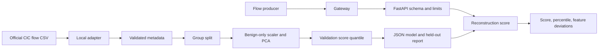

# NetworkAnomalyDetector

Unsupervised anomaly scoring for network-flow metadata. The project learns a benign baseline with PCA reconstruction error, returns continuous anomaly scores and feature deviations, and includes a bounded FastAPI service, CIC-IDS2017 preparation, Docker, tests, and CI.

## Overview

The detector highlights flows that differ from a learned baseline. A high score indicates deviation from training data, not confirmed malicious activity. Operators can use it for investigation and SIEM enrichment without automatic remediation.

## Features

- Validated flow schema and deterministic packet/byte/rate features.
- Locally prepared official CIC-IDS2017 metadata with no packet payload reading.
- Group-disjoint train/validation/test partitions and benign-only model fitting.
- Validation-only threshold from a configurable benign score quantile.
- Held-out attack evaluation, JSON model artifact, and per-feature reconstruction errors.
- Optional API key, body/batch/concurrency/time limits, structured logs, Prometheus metrics, Docker, and CI.

## Architecture



## How It Works

The adapter maps official CICFlowMeter fields to a stable numeric schema. It hashes source/destination IP pair and one-minute capture window into a grouping ID, but IPs are not model features. Training validates rows, rejects label conflicts on identical features, removes exact duplicate feature vectors, and keeps groups exclusive across partitions. A scaler and PCA are fitted to benign training rows only. Benign validation scores set an alert threshold; labeled test flows provide evaluation metrics. Inference compares a flow with the saved baseline and returns reconstruction error.

## Machine Learning Approach

PCA is an unsupervised reconstruction model. It retains the configured number of components and measures mean squared error after reconstruction in standardized feature space. The score is continuous and uncalibrated as a probability. `baseline_percentile` compares the score with benign validation quantiles. `anomaly_flag` is a threshold indicator and must not be interpreted as proof of attack. Feature deviations are squared residuals, not causal explanations.

## Dataset

Use the [official CIC-IDS2017 labeled flow CSVs](https://www.unb.ca/cic/datasets/ids-2017.html), downloaded manually. The Canadian Institute for Cybersecurity page describes public research availability and asks users to cite Sharafaldin, Habibi Lashkari, and Ghorbani (2018); verify any additional terms for your use. The adapter requires `Label`, `Source IP`, `Destination IP`, `Timestamp`, and selected numeric CICFlowMeter columns. It maps supported labels and reports skipped rows. No dataset or packet capture is bundled. The 2017 lab capture may not represent present-day traffic.

## Features Used

Inputs: duration, destination port, protocol, forward/backward packet and byte counts, SYN/ACK counts, average packet size, and active/idle mean durations. Derived features: total packets, total bytes, bytes per packet, forward packet ratio, packets per second, and SYN packet ratio. Values are bounded and finite. No DNS or external service is contacted.

## Model Training

`configs/training.json` sets the seed, split fractions, PCA component count, benign threshold quantile, and dataset size limits. Training writes `models/model.json` and `models/model.metadata.json`. The metadata records source SHA-256, configuration, split counts, fit policy, threshold selection, held-out metrics, and model version. Both artifacts are ignored by Git.

## Model Evaluation

Benign and attack labels are used to evaluate the untouched test split, not to fit PCA or tune the threshold. The test distribution is not artificially balanced. Evaluate separately on later time windows and a different network before production use; a lab benchmark cannot establish real false-positive volume.

## Metrics

The test report includes precision, recall, F1, ROC-AUC, PR-AUC, false-positive rate, false-negative rate, confusion matrix, and support for benign/attack at the validation-set threshold. `/metrics` exposes request and prediction totals, inference errors, and latency histogram. No benchmark score is claimed until trained on research data.

## API

Endpoints: `GET /health`, `GET /ready`, `GET /version`, `GET /metrics`, `POST /api/v1/predict`, and `POST /api/v1/batch-predict`. Requests use explicit `flow` or `flows` schemas. Responses include `anomaly_score`, `anomaly_flag`, `threshold`, `baseline_percentile`, `risk_score`, `model_version`, and five feature deviations. `risk_score` is a percentile-style display value, not a threat probability. `/ready` returns 503 without a valid model. The optional `X-API-Key` protects inference and metrics; production mode requires a strong key.

## Installation

Use Python 3.12+. From a fresh clone:

```bash
git clone https://github.com/Arjunren/NetworkAnomalyDetector.git
cd NetworkAnomalyDetector
python -m venv .venv
# Activate .venv using your shell's standard command.
python -m pip install -e ".[dev]"
pre-commit install
```

## Configuration

Copy `.env.example` to `.env` and configure the API key, model path, and resource limits. Training hyperparameters are in `configs/training.json`. Review metrics and artifact provenance before model promotion.

## Environment Variables

| Variable | Purpose | Default |
| --- | --- | --- |
| `APP_ENV` | `development`, `test`, or `production` | `development` |
| `LOG_LEVEL` | Structured logging level | `INFO` |
| `MODEL_PATH` | JSON artifact | `models/model.json` |
| `API_HOST`, `API_PORT` | Local bind settings | `127.0.0.1`, `8000` |
| `API_KEY` | Shared key for inference and metrics | empty in development |
| `MAX_BATCH_SIZE` | Maximum flow records per call | `100` |
| `MAX_REQUEST_BYTES` | JSON body limit | `1048576` |
| `MAX_CONCURRENT_INFERENCE` | Worker/admission cap | `4` |
| `INFERENCE_TIMEOUT_SECONDS` | Queue and response timeout | `2` |

## Running Locally

Download official CSVs manually and prepare them using `scripts/prepare_cic.py`. Train the model, then run `make serve` or `uvicorn network_anomaly_detector.api:app --host 127.0.0.1 --port 8000`. For a self-contained smoke test, run `python scripts/generate_test_data.py` and train on its synthetic CSV. Synthetic scores do not establish detection quality.

## Running with Docker

Train first so `models/model.json` is included in the image. Set a strong `API_KEY` and `APP_ENV=production` in `.env`, then run `docker compose build && docker compose up`. The non-root container uses a read-only root filesystem, dropped capabilities, a health check, and Compose CPU/memory/process limits. Put TLS, per-client rate limits, and identity/authorization at a gateway for shared use.

## Training the Model

```bash
python scripts/prepare_cic.py --input data/raw/Wednesday.csv data/raw/Friday.csv --output data/processed/cic_flows.csv
network-anomaly-detector train --dataset data/processed/cic_flows.csv --model models/model.json --config configs/training.json --version 1.0.0
```

Use enough independent benign and attack capture groups to populate all partitions; the pipeline fails clearly if not. Assign a new semantic model version after retraining or changing features.

## Running Inference

```bash
network-anomaly-detector predict --flow examples/flow.json
network-anomaly-detector evaluate
```

The example flow is synthetic metadata; the CLI does not capture live traffic.

## API Examples

```bash
curl -H 'Content-Type: application/json' -H 'X-API-Key: replace-with-configured-key' \
  -d '{"flow":{"duration_ms":1000,"destination_port":443,"protocol":6,"fwd_packets":10,"bwd_packets":8,"fwd_bytes":1200,"bwd_bytes":800,"syn_flags":2,"ack_flags":3,"avg_packet_size":100,"active_mean_ms":50,"idle_mean_ms":25}}' \
  http://127.0.0.1:8000/api/v1/predict
```

Batch requests use `{"flows":[{...},{...}]}`. Neither request nor response contains packet payloads.

## Testing

Run `make lint`, `make typecheck`, `make test`, and `make security`. Tests cover validation, feature extraction, adapter preparation, group splitting, model serialization, anomaly scores, malformed/oversized requests, authentication, and corrupted artifacts. They use synthetic metadata and never contact live malicious infrastructure.

## Security

The API treats all metadata as untrusted numeric input and rejects extra/malformed values, non-JSON content, oversized bodies, and excessive batches. The service never executes packet payloads or reaches external hosts based on flow content. The JSON artifact has fixed schema, finite numeric values, a size cap, and checksum; it cannot contain executable pickle. SHA-256 is not an authenticity signature. Logs omit IPs, flow values, and credentials. See `docs/security.md`.

## Project Structure

`src/network_anomaly_detector/` contains flow validation, feature extraction, PCA training, artifact handling, CLI, settings, and API. `scripts/` prepares CIC data and creates synthetic smoke fixtures. `configs/`, `data/`, `models/`, `docs/`, `notebooks/`, `tests/`, and `.github/workflows/` provide separation of concerns.

## Monitoring and Observability

Scrape authenticated `/metrics` with Prometheus and display latency, errors, prediction volume, and readiness in Grafana. Monitor score distributions, feature drift, alert volume, and analyst-confirmed outcomes. Never use IPs or flow fields as metric labels or log them without a privacy basis.

## Limitations

Unusual traffic is not necessarily malicious, and malicious traffic can resemble the baseline. PCA captures linear relationships and may miss subtle temporal behavior. Baseline contamination, seasonal variation, and old lab data can raise false positives. The displayed percentile is not calibrated attack probability. The shared API key does not provide tenant-level authorization.

## Future Improvements

Add time-sliced evaluation, robust baselines per service, drift-aware retraining, probability-free alert calibration, and optional Zeek/Suricata flow adapters. Kafka, OpenSearch, and Grafana integrations can be deployed around this service without changing its trust boundary.

## Responsible Use

Use anomaly scores as investigation leads with analyst review. Do not automatically block hosts or users based on the model alone. Follow source dataset citation requirements and privacy policies; do not commit raw flow records or sensitive IP addresses.

## Contributing

Submit reproducible issues or focused pull requests with synthetic fixtures. Run quality checks and avoid including packet payloads, credentials, private telemetry, or trained models.

## License

Code is MIT licensed. CIC-IDS2017 is external and subject to its source terms and citation request.
