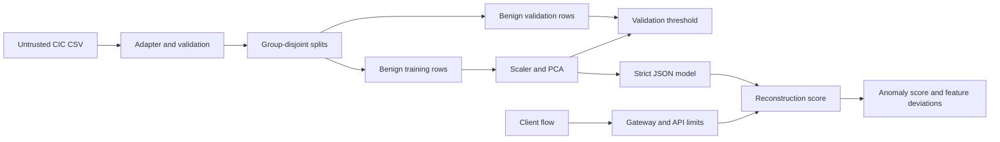

# Architecture

## Components and data flow

The offline adapter normalizes CIC-IDS2017 flow metadata without reading packet payloads. The training CLI validates records, removes exact duplicate features, groups by IP-pair/minute hash, and creates deterministic train/validation/test partitions. It fits scaling and PCA only on benign training rows, derives a threshold and score quantiles only from benign validation rows, and uses labels in the untouched test partition for evaluation. The API validates each request, loads the JSON artifact, and scores flows in a bounded worker pool.

## Trust boundaries

CSV files, flow fields, HTTP bodies, headers, and model artifacts are untrusted. The API does not call out to submitted IPs or domains. A gateway supplies TLS, client identity, authorization, and rate limits. Artifact provenance depends on reviewed storage and release process; its embedded SHA-256 only detects accidental or unsanctioned changes.

## Lifecycle and deployment

Version model artifact and feature schema together. Review benign baseline coverage, contamination, test support, score drift, and live feedback before promotion. Keep data and model files outside Git. Docker serves a pre-trained model as a non-root read-only process. Prometheus/Grafana monitor aggregate health without sensitive flow labels.
